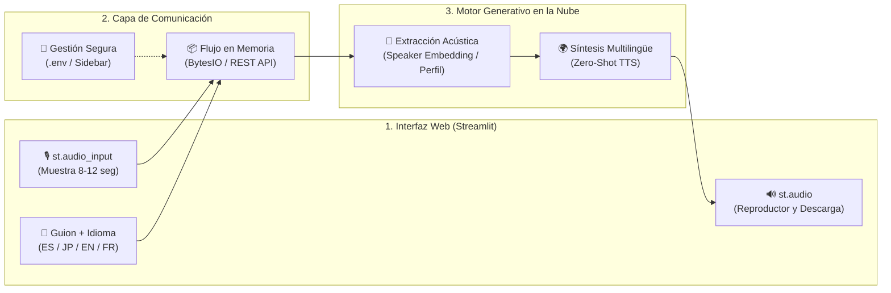

# 🎙️ Tu Voz en Cualquier Idioma: Clonación y Síntesis Vocal con IA

Repositorio oficial del taller práctico (*Hands-on* / *Code-along*) para construir una aplicación web en **Streamlit** capaz de capturar tu voz desde el navegador, extraer su perfil acústico (*Speaker Embedding* / perfil vocal) y sintetizar voz multilingüe en segundos mediante APIs en la nube.

---

## 🏗️ Arquitectura del Sistema

El sistema separa la interfaz ligera del cómputo pesado en GPU mediante una arquitectura en 3 capas:



---

## 🚀 Instalación Rápida en 3 Pasos

### Paso 1: Clonar el repositorio e instalar dependencias
Asegúrate de tener **Python 3.9+** instalado y ejecuta en tu terminal:

```bash
git clone <URL_DEL_REPOSITORIO>
cd TallerDIA
pip install -r requirements.txt
```

### Paso 2: Configurar tu API Key
Copia el archivo de plantilla `.env.example` como `.env` y coloca tu clave:

```bash
cp .env.example .env
```

Edita el archivo `.env` con tu clave (también puedes pegarla directamente en la barra lateral de la aplicación al abrirla):
- **OpenAI API Key (`sk-proj-...`)**: Activa automáticamente el pipeline de análisis acústico + síntesis multilingüe de OpenAI.
- **ElevenLabs API Key**: Activa automáticamente el pipeline de *Instant Voice Cloning* (`eleven_multilingual_v2`).

> ⚠️ **Seguridad:** El archivo `.env` está excluido en `.gitignore` para evitar que tu API Key se suba por accidente a GitHub.

### Paso 3: Ejecutar la aplicación
Inicia el servidor local de Streamlit:

```bash
streamlit run app.py
```

Se abrirá automáticamente en tu navegador en `http://localhost:8501`.

---

## 📂 Estructura del Proyecto

```text
├── app.py                # Aplicación principal en Streamlit (comentada paso a paso)
├── requirements.txt      # Dependencias mínimas (streamlit, requests, python-dotenv)
├── .env.example          # Plantilla segura para variables de entorno
├── .gitignore            # Protege .env y archivos temporales para repositorios públicos
├── muestra_respaldo.wav  # Audio de respaldo por si falla el micrófono en el salón
└── README.md             # Guía de inicio rápido y arquitectura
```

---

## 🛡️ Uso Ético y Responsable
Esta herramienta fue creada con fines **estrictamente educativos** para demostrar el funcionamiento de vectores de identidad vocal y síntesis generativa multilingüe. Nunca utilices muestras de voz de terceros sin su consentimiento explícito.
